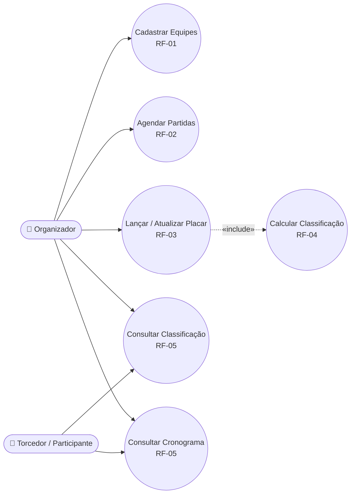
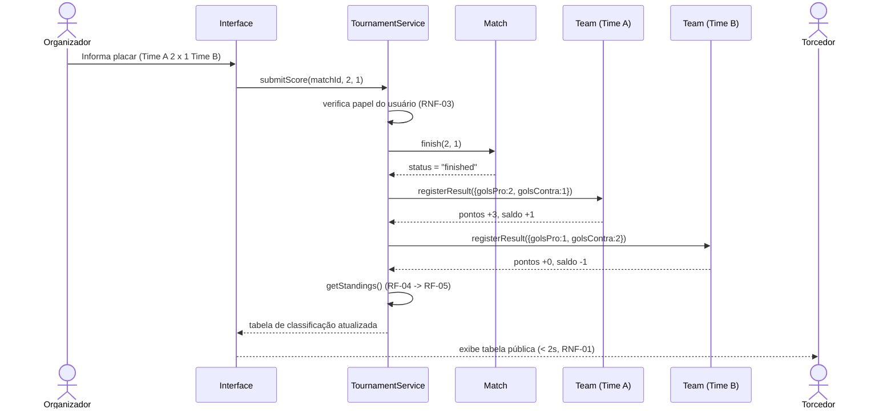
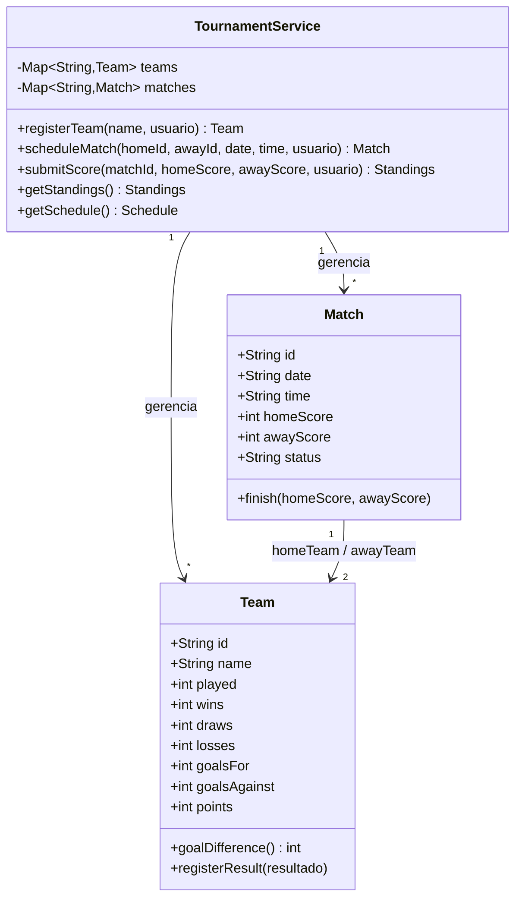

# Sprint 3 – Modelagem e Rastreabilidade dos Requisitos

**Projeto:** Sistema de Gestão de Torneios
**Sprint:** 03 · **Tag:** `sprint-03`

Este documento representa, por meio de modelos, como o domínio e os fluxos do
sistema descritos na Sprint 2 (RF-01 a RF-05, RNF-01 a RNF-03, US-01) estão
organizados. Os arquivos-fonte dos diagramas (`.mmd`, em sintaxe Mermaid)
estão em `docs/modelagem/diagramas/` e são renderizados automaticamente pelo
GitHub dentro deste próprio arquivo — não dependem de link externo.

---

## 1. Modelo Comportamental 1 — Diagrama de Casos de Uso

**Finalidade:** mostrar quem interage com o sistema e quais funcionalidades
cada ator pode acionar, deixando explícito que o cálculo da classificação
(RF-04) nunca é disparado diretamente por um ator — ele é uma consequência
automática de RF-03, daí o relacionamento `«include»`.

**Elementos:**
- **Atores:** Organizador (autenticado) e Torcedor/Participante (público).
- **Casos de uso:** Cadastrar Equipes (RF-01), Agendar Partidas (RF-02),
  Lançar/Atualizar Placar (RF-03), Calcular Classificação (RF-04, incluído
  por RF-03), Consultar Classificação e Consultar Cronograma (RF-05).

**Decisão de modelagem:** "Calcular Classificação" foi modelado como caso de
uso incluído, e não como caso de uso acessível por um ator, porque nenhum
requisito prevê acionamento manual do recálculo — ele é sempre consequência
de um placar lançado (ver RNF-01).

---

## 2. Modelo Comportamental 2 — Diagrama de Sequência (US-01)

**Finalidade:** detalhar passo a passo o fluxo de "lançar o placar de uma
partida finalizada", cobrindo os dois critérios de aceitação de US-01 e
evidenciando onde RNF-01 (recálculo em menos de 2s) e RNF-03 (apenas
Organizador altera dados) se aplicam no fluxo.

**Elementos:** Organizador e Torcedor (atores), Interface, `TournamentService`
(orquestrador dos casos de uso) e as entidades `Match`/`Team`.

**Decisão de modelagem:** a verificação de papel do usuário (RNF-03) foi
posicionada como o primeiro passo dentro de `TournamentService`, antes de
qualquer alteração de estado — nenhuma escrita ocorre em `Match` ou `Team`
sem essa checagem passar primeiro.

> **Nota sobre o incremento desta sprint:** o código em `src/` implementa por
> enquanto apenas os **atributos e associações** das classes. Os métodos
> mostrados neste diagrama (`submitScore`, `finish`, `registerResult`,
> `getStandings` etc.) e as regras de negócio que eles carregam ficam para o
> próximo incremento — ver item correspondente no backlog (seção 6).

---

## 3. Modelo Estrutural — Diagrama de Classes

**Finalidade:** representar o domínio do sistema (equipes, partidas e o
serviço que orquestra as regras de negócio) e servir de base direta para o
código em `src/`.

**Elementos e decisões:**
- **`Team`** guarda apenas os dados que RF-04 exige (jogos, vitórias,
  empates, derrotas, gols pró/contra, pontos); `goalDifference` é calculado
  a partir de `goalsFor`/`goalsAgainst` em vez de armazenado, evitando dado
  duplicado que poderia ficar inconsistente.
- **`Match`** guarda `status` (`scheduled`/`finished`) para impedir, por
  regra de domínio, que um placar já lançado seja sobrescrito por engano.
- **`TournamentService`** concentra as regras de RF-01 a RF-05 e a checagem
  de RNF-03, em vez de deixar essa lógica espalhada pela interface — é o
  único ponto de entrada que altera `Team` e `Match`.
- A associação `Match "1" --> "2" Team` modela que toda partida referencia
  exatamente duas equipes (mandante e visitante).

> **Nota sobre o incremento desta sprint:** o código já implementa os
> atributos e associações abaixo tal como modelados. Os métodos (`+algo()`)
> ainda não foram implementados — ficam para o próximo incremento.

---

## 4. Matriz de Rastreabilidade — Requisitos × Modelos × Código

| Requisito / História | Caso de Uso | Sequência (US-01) | Classe | Código (`src/`) nesta sprint |
|---|---|---|---|---|
| RF-01 | UC1 – Cadastrar Equipes | — | `Team` (atributos) | `models/Team.js` — struct pronta; método `registerTeam` fica para o próximo incremento |
| RF-02 | UC2 – Agendar Partidas | — | `Match` (atributos) | `models/Match.js` — struct pronta; método `scheduleMatch` fica para o próximo incremento |
| RF-03 | UC3 – Lançar/Atualizar Placar | Passos 1–4 (Organizador → `Match.finish`) | `Match` (atributo `status`) | `models/Match.js` — atributo `status` já existe; método `finish`/`submitScore` fica para o próximo incremento |
| RF-04 | UC4 – Calcular Classificação (`«include»` de UC3) | Passos 5–8 (`registerResult`) | `Team` (atributos `points`, `goalDifference` etc.) | `models/Team.js` — atributos já existem; método `registerResult` fica para o próximo incremento |
| RF-05 | UC5, UC6 – Consultar Classificação/Cronograma | Passos 9–10 (retorno à Interface/Torcedor) | `TournamentService` (atributos `teams`, `matches`) | `services/TournamentService.js` — struct pronta; métodos `getStandings`/`getSchedule` ficam para o próximo incremento |
| RNF-01 (desempenho < 2s) | — | Nota final do diagrama de sequência | — | Depende dos métodos ainda não implementados |
| RNF-02 (responsividade) | — | — | Fora do escopo desta sprint (camada de front-end) | — (ver backlog) |
| RNF-03 (segurança) | Precondição implícita em UC1, UC2, UC3 | Passo "verifica papel do usuário" | — | Depende do método `_assertOrganizer`, ainda não implementado |
| US-01 (Critérios 1 e 2) | UC3 + UC4 | Diagrama completo | `Team`, `Match` (atributos e associação) | `test/tournamentService.test.js` valida hoje só a estrutura (atributos e associações); os critérios de aceitação em si dependem dos métodos do próximo incremento |

---

## 5. Requisitos esclarecidos nesta sprint

- **RF-04:** o requisito original não definia o critério de desempate da
  tabela de classificação. A modelagem tornou essa lacuna explícita; foi
  adotado o critério usual de pontos corridos: **1º pontos → 2º saldo de
  gols → 3º gols pró → 4º ordem alfabética** (implementado em
  `TournamentService.getStandings`). Sugestão: atualizar o texto de RF-04 no
  documento de requisitos para registrar esse critério.

## 6. Backlog atualizado (itens identificados durante a modelagem)

- **Implementar os métodos das classes** (`Team`/`Match`/`TournamentService`)
  com as regras de negócio de RF-03/RF-04/RF-05 — nesta sprint o incremento
  ficou limitado a atributos e associações, por decisão de escopo.
- Implementar a checagem de papel do usuário conforme RNF-03 (hoje nem o
  atributo/mecanismo de papel do usuário existe no código ainda).
- Persistir equipes/partidas em banco de dados (o `Map` em memória em
  `TournamentService` não sobrevive a um reinício do processo).
- Construir a interface pública responsiva (RNF-02) — não coberta por este
  incremento, que é apenas a camada de domínio/serviço.
- Validar entradas de agendamento e de placar (datas, IDs inexistentes,
  valores negativos) quando os métodos forem implementados.
- Cobrir com testes automatizados o critério de desempate (pontos → saldo de
  gols → gols pró → ordem alfabética) assim que `getStandings` existir.

## 7. Visão geral

Nenhuma mudança relevante de escopo foi identificada nesta sprint. O escopo
negativo (sem cartões/artilharia, sem mata-mata) permanece válido; a
modelagem apenas tornou explícito um detalhe de regra de negócio (critério
de desempate) que já estava implícito no RF-04.
